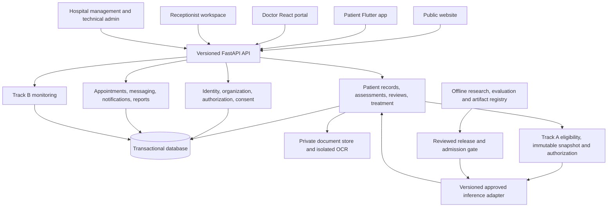

# CardioAssist-AI — Unified Full-System Master Workflow

**Document ID:** CAI-FULL-WORKFLOW-v1.0 | **Date:** 2026-11-28  
**Status:** OWNER-DIRECTED FINAL DELIVERY PLAN — published for review; planning baseline, not an approval of research contracts, model serving, real-data work, clinical deployment, gate closure or merge. This version supersedes the conversation draft v0.1 after human review/merge; it does not supersede controlling decisions.  
**Priority (D-045 reaffirmed by owner in chat):** (1) complete AI & Research, (2) complete integration-ready backend, (3) complete durable tested database. Frontends remain team deliverables.  
**Verified publication base:** `c6a6bdee46a552a2b0d705a723c862ff8a95be4d`.  
**Repository:** Muhammed-Fathi/CardioAssist-AI

## 1. Purpose and source reconciliation

Build one longitudinal cardiology care platform, not a standalone CAD calculator. Preserve the offline AI & Research work and integrate only eligible, versioned model artifacts through an explicitly authorized service boundary. The public website, patient app, doctor portal, reception, hospital management and technical administration share the same authorized records. A failure of AI, OCR, or a wearable integration must not prevent ordinary care workflows.

Sources studied as design inputs, not blindly binding instructions:

- S1: `CardioAssist_AI_Implementation_Specification.pdf`, 57 PDF pages (doctor/public web). §§6–16 cover portal, patients, connection requests, assessment, messaging, reports, notifications and settings. §§18–19 cover logical entities and security.
- S2: `CardioAssist_AI_System_Reference-12-37.pdf`, 26 PDF pages (patient journey and all 22 patient features). PDF p1 shows the eight-stage journey; pp2–26 describe F1–F22.
- S3: `CardioAssist AI System Documentation.pdf`, 46 PDF pages (institution/roles, patient features, appointment lifecycle, architecture, proposed DB/API). PDF pp4–6 define roles and journey; pp34–36 define appointment/leave flows; pp36–37 separate the deferred AI layer; pp44–46 provide traceability/open items.
- S4: software-team workflow `Pasted text(20261128-031620).txt`, stages 1–12. It is the operational UI starting point, including account lifecycle, registration, assessment, wearable data, chat, reminders and doctor dashboard.
- R1: [research exact HEAD](https://github.com/Muhammed-Fathi/CardioAssist-AI/tree/46e7a2995987dc9dbf7dab545de8eda27fb9a6b1), PR #141 OPEN/DRAFT. RH-04 evidence available; V1 forced-dispatch failure retained; formal gates open. [RD-01–10](https://github.com/Muhammed-Fathi/CardioAssist-AI/blob/46e7a2995987dc9dbf7dab545de8eda27fb9a6b1/docs/research/next_phase/RH06_EVIDENCE_BOUNDED_RESEARCH_PROTOTYPE_DESIGN_DECISIONS_2026_11_19.md), [roadmap](https://github.com/Muhammed-Fathi/CardioAssist-AI/blob/46e7a2995987dc9dbf7dab545de8eda27fb9a6b1/docs/GRADUATION_DELIVERY_ROADMAP.md), and blueprint 01/02/04 remain governing where applicable.
- R2: [Term-1 exact HEAD](https://github.com/Muhammed-Fathi/CardioAssist-AI/tree/5c96a2b9d5438b6600cf5eebebb70294fdeeadad), PR #142 OPEN/DRAFT. `docs/term1/TERM1_INTEGRATED_PROTOTYPE_MASTER_PLAN_20261125.md`, `TERM1_DELIVERY_PLAN_AMENDMENT_REAL_AI_OCR_20261127.md`, `TERM1_C2_FINAL_INTEGRATION_DESIGN_AND_READINESS_20261127.md`, and stage/decision ledgers. Bounded C1 identity/auth/visit/enrollment baseline accepted within the prototype delivery track; later HTTP closure and C2 readiness have outstanding review/authorization. A1/A2/A3/B remain pending. Do not treat the overall PR as merged into main.

Existing decision records, source rights, frozen tests, research contracts and explicit owner grants outrank this proposal. Do not overwrite historical specifications or reuse their feature IDs for different meanings. S2 F1–F22 are patient-facing feature IDs, not the repository blueprint's F01–F18. Cross-reference by source and label.

## 1A. Binding delivery direction and finite AI research selection checkpoint

The owner explicitly rejects treating the five-feature Term-1 demonstration as the final research scope. The full-system research objective is a reproducible, source-specific model-development/evaluation and inference framework, with a defensible model-selection decision; the final number of admitted models is determined by evidence, not a quota. Compare multiple algorithm families and justified panels; one selected model may legitimately win a particular task, and other candidates may remain research-only. No arbitrary requirement for two deployed models, maximal features, deep learning, or an ensemble. "Complete" means delivered in-scope capabilities plus a justified, reviewed disposition for scientifically inadmissible studies, never fictional performance or a silent omission. Clinical deployment is not a graduation requirement.

### R-MODEL — candidate register and decision matrix

Preserve the existing AI master completion plan, RD-01–10, D-040/045/046/047/048/049, the original source reviews, and all frozen evidence. The current estimand remains source-defined cross-sectional angiography-referenced CAD classification within historical referred cohorts; no automatic equivalence between Cleveland's historical >50% wording and UCI-412 >=50%, no future-event prediction, no clinical probability, no treatment model. New objectives are separately scoped, not a UI change.

| Candidate / role | What exists | Full delivery decision |
|---|---|---|
| Cleveland DA-A2 five-field resting (age, sex, cp, trestbps, restecg) | D-047 bounded local internal exploratory comparison; research bundle, synthetic-input inference evidence; Term-1 candidate; no automatic serving rights | Preserve as baseline; review aggregate performance and actual fitted artifact independently. Compare only permitted same-source alternatives. ECG and resting BP are measured clinical facts, not patient guesses. |
| Cleveland resting + routine labs (chol, fbs) | Proposed extension, not covered by existing D-047 authorization | Screen source dictionary, units, chronology, complete paired cases and sample adequacy. Separate protocol/authorization; incremental-value test on same people and same splits if admitted. |
| UCI-412 DA-A1 16-field basic clinical | Source-specific research route, synthetic engineering and historical M3a aggregate; scientific hold on final use (0/16 verified patient-level pre-reference timestamps per RD-03) | Review actual registered panel and feasibility; no cross-source winner or claim that timing resolved. Candidate for research comparison/independent demo only if required authorization and evidence permit. |
| UCI-412 clinical + laboratory extensions | Proposed/blocked panels, synthetic paired method exists | Same-source paired experiment only with verified definitions, timing, rights, sample adequacy and separate protocol. |
| Hungary | Locked external target candidate for a predeclared eligible Cleveland model | Verify target/panel/population, independence, adequate precision and authorization; freeze artifact and analysis before one-shot evaluation, no tuning on test site. RD-07 remains NO-GO for current release. |
| VA Long Beach, Switzerland | Source suitability / missingness / domain-shift audit | Assess feasibility, quantify missingness and limits; no forced fit or pooling. |
| UCI-411, Statlog | Overlap/leakage audit roles | UCI-411 is not independent of UCI-412; Statlog independence unresolved. No train/validation use outside reviewed scope. |
| AngioCAD | Rejected supervisor-source classification / unresolved suitability | Retain rejection; no acquisition or model use unless explicit new evidence and decision. |

The original research has a multi-dataset strategy, not eight interchangeable training datasets. Use official repository/source paper and the existing supervisor green/maybe/red list. Candidate new sources are only justified by a concrete missing requirement (compatible target, independent site, sufficiently precise sample, verified routine pre-reference features); not a search for impressive metrics.

Algorithm comparison: retain prevalence/dummy baseline, L2 logistic regression, constrained random forest. Additional bounded gradient boosting is a proposal only, requiring rationale and identical evaluation within an eligible source. No extra model simply to increase count. Use predeclared repeated nested CV, participant-level separation, fold-contained preprocessing/imputation/selection, training-only hyperparameter search and OOF calibration as applicable; leakage exclusions, permutation control, uncertainty and independent tests. Report AUROC/AUPRC where meaningful, sensitivity/specificity only at stated research thresholds, Brier/calibration slope/intercept/plots, confidence intervals, missingness and sample adequacy, limitations and compute. Do not compare AUROC across unlike cohorts as a ranking. Compare simpler vs richer panel on identical paired cases and splits; report uncertainty in incremental value. SHAP/LIME must use the actual selected model, valid feature mapping and reviewed background/scale; feature contributions are not causes. No patient-facing risk bands, causal advice, automated diagnosis or prescriptions from these scores.

Primary evidence anchors (read with existing repository claim/source inventory): official [UCI Heart Disease](https://archive.ics.uci.edu/dataset/45/heart+disease), [UCI-412](https://archive.ics.uci.edu/dataset/412/z+alizadeh+sani), [TRIPOD+AI (BMJ 2024)](https://www.bmj.com/content/385/bmj-2023-078378), [PROBAST+AI (BMJ 2025)](https://www.bmj.com/content/388/bmj-2024-082505). These establish source/method guidance, not project-specific performance or approval. For any new scientific question, identify the exact missing fact, read primary papers, original data dictionaries, official repositories and relevant professional guidance; use secondary material to find sources, not as clinical authority. Record DOI/URL, actual inspected evidence, population, endpoint, applicability and limitations. A paper cannot establish unavailable individual patient measurement chronology by inference alone.

### Finite work and stop rule (no endless research loop)

1. Finish RH-04 existing acceptance correction, exact-head rollback and explicit owner decisions; no parallel change to its scientific contracts, fixture digests or V1 policy.
2. Finish RH-05 engineering/security/reproducibility, RH-03 methods/manuscript, RH-07 review and RH-08 freeze in the existing dependency order. RH-00/01/02/06 are reconciled, not restarted. The existing educational research release remains bounded by RD-06/RD-07 NO-GO.
3. Run one bounded model-selection readiness checkpoint (R-MODEL) in parallel as read-only planning after RH-04 evidence, and reconcile at RH-07/RH-08. Produce a candidate matrix, eligible data/panels/algorithms, existing evidence vs missing proof, and a primary/secondary research choice or precise NO-GO. Allow at most one targeted source-review follow-up per unresolved candidate in this checkpoint; stop when the specific proof is established or missing, rather than repeatedly asking the same question. New experiments require a named protocol, data rights, exact owner/local execution permission and reviewer acceptance. If an essential expansion is newly admissible, open a separately scoped research revision with frozen design, one planned execution and acceptance before final full-system model handoff. If evidence cannot admit it, document the reason, retain baseline and conditional route as not eligible, and finish the bounded release. Do not silently overturn RD-06/RD-07, scientific holds or P-3. No real-data download/fitting by hosted agents.
4. Freeze model selection for this delivery: a signed decision table naming the actual artifact(s), chosen route(s), rejected candidates, exact feature schema, target and calibration, metrics with provenance, limitations, use restrictions, and evidence IDs. Any future expansion becomes a new version with a new protocol, never scope creep in the accepted release. The release cannot claim a five-feature model is scientifically optimal absent comparative evidence; it also cannot claim a wider model was trained if not performed.
5. Hand off a versioned AI package and test oracle to backend: registry, schema/units/encoding/source allowlist, model/artifact digest and trust anchor, versioned inference/status and explanation contract, abstention/error/no-fallback rules, model card, evaluation and reproducibility evidence, local install/rollback. At least one genuine explicitly admitted trained-model computation is the target for the educational integration (not fabricated mock output). If no model is authorized, keep the endpoint unavailable and report the blocker, not full completion. RH-04 Lane B verifies frozen replay, not model scientific validity or eligibility. Separate permissions for data, fitting, artifact admission, serving, display and real deployment. No data or private artifact custody transfer through GitHub/hosted agents.

### Full-system definition of done (three owner-priority deliverables)

| Deliverable | Acceptance target |
|---|---|
| AI & Research | RH-04/05/03/07/08 exact evidence and approved model-selection packet, versioned registry/inference/XAI/reproducibility, documented dataset roles and all justified study dispositions; no artificial scope expansion or unsupported clinical claim. |
| Backend | Functional versioned FastAPI contracts for all accepted U01–U11 modules below, authorization and lifecycle, model-admission boundary, OCR and monitoring interfaces, queues/reviews, scheduling, medications, communication, reporting and notifications. Happy paths and negative paths, no placeholders presented as complete. |
| Database | Inventory and reuse existing SQLAlchemy/Alembic schema, complete domain ERD and data dictionary, durable transactions, immutable provenance/history, constraints, indexes, migration/rollback, recovery/restart and concurrency tests. SQLite local baseline; PostgreSQL is target proposal for full-system concurrency, not parity claim until actually exercised. No production patient data. |

Priority is research first, backend second, database third; database design and migrations are prerequisites for each persistent backend slice, not something postponed until all endpoints are written. Design contracts and schema together; implement/test vertical slices so no duplicate stores or later destructive rewrite. Deliver the three as separately reviewable packages with a final integrated synthetic end-to-end demonstration. React/Flutter/public and staff surfaces are software-team work, integrated against tested contracts. Missing clinical validation does not block educational delivery; missing in-scope engineering evidence does.

## 2. Proposed architecture and responsibility boundaries

- Keep the existing FastAPI modular-monolith approach and React/Flutter direction. Clients do not access the database or model directly. SQLite is the existing local prototype baseline; PostgreSQL is a proposed full-system target requiring reviewed migrations and concurrency/transaction tests. Use private, integrity-checked file storage and a durable outbox for delivery events; exact technology/policy choices remain open.
- Five product roles: patient, doctor, receptionist, hospital management, system administrator. One hospital/medical-center cardiology department is a practical initial integration scope; support explicit organization IDs before extending to multi-site deployments. Separation of technical and hospital admin duties must be explicit. No role receives medical record access merely because it is administrative.
- One patient account per verified identity; default one primary treating doctor per care context. Reuse assignment relations supporting multiple separately authorized assignments rather than adding a global `patient.doctor_id`. Additional doctor access is not implied by booking a visit or by shared hospital membership. Consent and authorization remain assignment-scoped.

## 3. Unified operational workflow

### U01 — Institution setup, public entry and staff accounts
Hospital management sets cardiology department, staff, working policies and code/slot rules. Technical admin provisions secure platform access and audit operations. Public site describes the service, doctor login and patient app; no anonymous inference. Admin provisions unique doctor/receptionist accounts, password setup and first-login restriction; hashed credentials, sessions, generic login/reset responses, expiry, rate limits and revocation. Doctor manages schedule and preferences; receptionist manages booking, not clinical records. Do not grant real-data use in the educational prototype.

### U02 — First encounter, access code, enrollment and patient requests
Keep the already agreed access-code correction, not the PDFs' generic hospital code or open connection request:
1. Doctor records an actual verified encounter attestation (fabricated identities/visit in demo), bound to organization, doctor, intended identity, actor and timestamp. An appointment may precede the visit, but a booking alone is not visit verification.
2. Doctor issues a random, short-lived, one-use invitation bound to verified visit, doctor and identity. Reception may deliver an already authorized code, but cannot issue one or assert a clinical encounter under the current plan. Use the existing secure verifier and keyed identity matching (no plaintext code or raw national ID in logs/Git/CI). No claim of government identity verification.
3. Patient registers with name, email, password and matching identifier/code; phone is a proposed optional/contract-reviewed field. Validate atomically: code, expiry, revocation, identity match, doctor status, authorization, uniqueness. Create account/assignment/consent and consume code together; handle concurrent redemption, generic errors and idempotency.
4. Existing patient logs in and redeems a new authorized invitation through the account-link flow, never creates a duplicate account. Default primary assignment changes and replacement doctor access require explicit consent and policy.
5. Successful activation appears in assigned doctor's directory and emits one durable notification. The Doctor Portal's separate Patient Requests page can show invitation/request history and separately approved additional-link/reassignment requests; no second mandatory approval for an already completed authorized redemption, no unrestricted Add Patient, no bypass of verified visit. If product wants remote pre-visit registration/requests, define a non-clinical booking-only flow separately; do not silently bypass this gate.

### U03 — Patient profile, consent and records
Patient signs in, completes editable demographics, contact, history, allergies, conditions, smoking/lifestyle/family/surgical history. Preserve author, time, source and edit history. Identity is not freely editable. Profile completeness is separate from eligibility of a particular model input panel. Store historical documents with metadata, private file access, checksum, upload limits, scanning and explicit authorization. Patient and doctor see only allowed records; consent withdrawal fences later reads, writes and in-flight inference as applicable.

### U04 — Document intake and OCR
Manual input works without OCR. Upload → validate and quarantine → integrity-checked storage → isolated extraction → editable draft (value, unit, timestamp, source, confidence) → patient confirmation → clinician verification where required → validated structured record → timeline. Failed/ambiguous/low-confidence extraction remains missing or requires correction; never invent values or replace original document. C2 bounded demo uses fabricated approved templates and a separate OCR exception/activation; no generic clinical OCR serving approval. Lab values may be stored and graphed without being model-eligible. Patient confirmation alone does not prove clinician verification or model eligibility. Relevant report count, size and source rules are contract decisions, not implicit from a UI.

### U05 — Track A: CAD research assessment
Patient may initiate an assessment request; assigned doctor may initiate from that patient's profile (not an unscoped global button). Both use the same versioned validation and inference orchestration. Select admitted route/panel; validate required fields, units, categories, source and approved freshness policy. If missing/unsupported/stale/unauthorized, give a safe reason, no score. Persist an immutable input snapshot and provenance before computation; run only an explicitly admitted artifact with the matching feature contract. Persist model ID/version, artifact digest, schema, snapshot digest, status, research score and permitted model-linked explanation, limitations and error/abstention. Never fallback to fake output. No stale success on retry/failure.

The existing Cleveland DA-A2 historical baseline (not the final feature-count decision) is the five-field panel `age, sex, cp, trestbps, restecg`; it does not accept the PDF's six-field panel (age, sex, systolic BP, total cholesterol, smoking, diabetes) as equivalent. UCI-412 DA-A1 is separate 16-field source-specific research. Neither route is a future-event or individual clinical probability model. No cross-source mapping by guess, pooling, arbitrary imputation, post-reference leakage, or wearable→CAD inference. A new target/panel/threshold requires independent research, data rights, evaluation and authorization; use R-MODEL above to decide the finite scope, not a hard-coded five-field UI. RD-09 currently keeps offline research separate from the legacy MOCK_SYNTHETIC HTTP provider. Term-1 educational reuse of existing historical real-data-trained Cleveland model is a separate candidate path requiring A1/A2/A3 and display B, not a consequence of RH-04 acceptance. No real patient data or private bundles in hosted tools.

### U06 — Review, reports and safe display
Successful inference enters `PENDING_REVIEW`; patient sees status, missing/next-step messages and clinician-approved published content. Default no score before separate display approval; the Term-1 proposal permits a distinctly labeled provisional research score/explanation before review only after B. Doctor sees authorized evidence and source report, snapshot, score and actual available explanations. SHAP/LIME are feature contributions, not causes or treatments; do not fabricate them. Doctor records append-only ACCEPTED / REJECTED / REASSESSMENT_REQUESTED with rationale; UI may map to Pending/Reviewed/Needs Info without losing exact state. Clinical judgment stays independent of model. No automated diagnosis, medication advice, risk band, high-risk CAD notification or clinical percentage with current model. Administrative priority = pending review, doctor flag, overdue follow-up; no automatic triage. Scenario exploration is isolated and labeled; only after eligible model/contract approval, never overwrite saved baseline or claim causal intervention effect. Reports preserve model version and review state; distinguish research assessment export, doctor-authored clinical/demo report and automated monthly summary.

### U07 — Track B: monitoring, device synchronization and history (parallel loop)
Manual measurements and consented smartwatch/activity-band sync → validate source, units, observed/received timestamps, capability, duplicates and quality → persistent time-series history → trends by period → doctor patient profile and patient dashboard. Show disconnected/last sync/missing states; no invented measurements. Do not treat wearable values as Track A features or automatic reassessment triggers. Simulator-first; actual provider and permissions separately verified. Health goals and approved doctor instructions independent of CAD score. Alert engine initially supports administrative/technical notifications; clinically meaningful monitoring severity, escalation, thresholds and emergency contacts require explicit clinician-approved rules, hospital policy, consent and testing. No emergency diagnosis from watch or chat. No claim of real-time emergency coverage.

### U08 — Appointments, receptionist and emergency leave
Doctor defines availability and planned leave. Patient requests a slot; backend reserves atomically for configurable TTL; receptionist confirms, rejects (reason policy), or proposes alternative. Canonical six statuses from S3 pp34–35: Pending, Confirmed, Alternative Proposed, Rejected, Cancelled, Completed. Rescheduling reserves new slot but leaves original confirmed until new acceptance; preserve status history and release expired/rejected holds. Patient accepts/declines proposal; cancellation releases slot unless leave blocks it; completed visit becomes timeline entry, not automatic verified identity. Doctor or authorized receptionist registers emergency leave with actor/time → block overlapping slots → identify affected visits → notify patients/reception → cancel/rebook or propose replacement under hospital policy. Patient consent required for replacement; appointment acceptance alone grants no unrestricted medical-record access. Doctor sees schedule and relevant follow-up, not default push per booking. Configurable patient reminders (24h proposed, not fixed). No double booking or orphaned holds.

### U09 — Treatment, medication, goals and adherence
Only assigned authorized doctor authors, updates, stops or publishes treatment plans, medication regimen and prescription; immutable version history and author. Patient sees plan and follows it, records taken/skipped/missed dose and views adherence. Personal reminders may be separately editable timing/preferences or personal non-prescribing reminders, never modify prescription name/dose/schedule/duration or present as doctor instructions. Doctor sees adherence history and adjusts plan via a new version. Lifestyle content is doctor-authored or reviewed generic education, not AI treatment recommendation. Prototype uses educational demo prescription only. No automatic prescriptions from CAD or wearable values.

### U10 — Messaging, notifications, follow-up and timeline
Assigned patient/doctor chat supports text and reviewed attachments/prescription PDF; drafts scoped to pair, unread/read state, idempotent writes, private downloads and access revocation. Chat not emergency channel. Durable domain event/outbox commits with the business record; notification recipient/visibility/idempotency enforced. Patient sees appointments, medication reminders, plan updates and authorized messages/results; doctor sees new patient, review requests, messages, approved follow-up events. Reception sees only operational events. Patient timeline joins appointments, documents, observations, assessments, reviews, plans, adherence and messages according to permissions. Store event IDs and UTC timestamps; UI shows local time. Monthly PDF is descriptive and clearly distinct from reviewed report, with missing data stated. Export honors permissions and does not fabricate statistics.

### U11 — Account lifecycle, privacy and administration
Patient manages allowed account fields, password, sessions/devices, consent, appearance/notifications and emergency contacts. Account closure/deletion is a request governed by retention and privacy policy; revoke sessions and access, do not blindly cascade medical/audit history. Separate deactivate/suspend/close/erase statuses and reasons, auditable authorization and applicable retention. Admin inactivity policy must be defined and safe; no deletion simply for inactivity. Notify permitted parties without PHI leakage. Technical admin monitors system, backups, audit, migration/restore; no blanket patient access. Test cross-organization isolation and revoked assignments.

## 4. Interface inventory and all patient features

Patient app (S2/S3 patient feature IDs):
| Feature | Unified workflow | Delivery disposition |
|---|---|---|
| F1 Dashboard | U03–U10 | Aggregate authorized data; empty/unavailable states |
| F2 Medical profile | U03 | Separate profile and model eligibility |
| F3 Medical records & reports | U03/U04 | Private storage, hash, authorization |
| F4 Automatic extraction | U04 | Human-confirmed; demo exception before Track A |
| F5 Smart device health data | U07 | Simulator first, actual connector gated |
| F6 Monitoring & history | U07 | Time-series, quality/source, charts |
| F7 Medication management | U09 | Doctor regimen; patient adherence |
| F8 Treatment & follow-up | U09/U10 | Doctor-authored versions |
| F9 Appointments | U08 | Six-state lifecycle, receptionist |
| F10 Notifications | U10 | Persisted events/outbox |
| F11 Chat | U10 | Authorized pair, attachments |
| F12 Personal health timeline | U10 | Event references, no overwriting |
| F13 Health alerts & warnings | U07 | Clinical severity rules gated |
| F14 Device connections | U07 | Consent, revocation, disconnect |
| F15 Automatic sync | U07 | Idempotency, timestamp, provenance |
| F16 Goals & activity | U07/U09 | Approved goals, not CAD thresholds |
| F17 Lifestyle recommendations | U09 | Doctor/generic approved education |
| F18 Monthly reports | U10 | Descriptive summary, distinct from clinician report |
| F19 Important/emergency alerts | U07 | Clinical policy gate; no emergency guarantee |
| F20 Emergency contacts | U11/U07 | Consent and escalation policy |
| F21 Privacy/sharing | U03/U11 | Scope and revocation |
| F22 Account/security | U01/U11 | Secure sessions and policy-based closure |

Doctor website per S1: public landing + authentication; dashboard with connected patients, assessment count, pending reviews, administrative follow-up; no global wearable detail or unapproved risk distribution. Directory table/card and search/filter. Nine tabs: Overview, Medical Profile, Assessments, Health Monitoring, Medical Records & Reports, Health Alerts, Appointments & Follow-up, Communication, Timeline. Separate Patient Requests; global assessment directory (not global create); messages, reports, notifications, settings. Doctor-side working hours, vacation and plan/prescription controls must link to canonical backend. No fabricated metrics or unimplemented controls. Reception workspace: booking queue, slots, leave, alternatives, reminders. Hospital management: staff, department, policies. System admin: technical security, audit and service health.

## 5. Reconciliation decisions and impact

| Conflict | Proposed resolution | Impact |
|---|---|---|
| Generic hospital code/open patient request vs existing verified visit | U02 identity-bound doctor invitation; separate requests for authorized links | Preserve C1; contract/UI reconciliation |
| Single doctor FK vs assignment model | One primary by default, relational authorized assignments | Backend/DB only; not auto-sharing |
| Six-field PDF panel vs five-field Cleveland | Registered model-specific form; broader profile may store extra fields; R-MODEL evaluates eligible broader panels | UI/API mapping for existing routes; separately authorized research for new panels |
| CAD Risk Percentage, Low/Moderate/High, automatic alerts | Research score + limits; pending review/doctor flag; no unsupported threshold | Wording, response schema, product logic; new research only if actual clinical target desired |
| Immediate patient score | Separate display grant B; hide by default | Authorization/UI/API |
| AI recommendations and scenario causal claims | Doctor-authored advice; isolated illustrative scenario only with approved model | Product and scientific review, no invented treatment |
| OCR confirmed by patient => model input | Clinician/source/route verification and explicit demo exception | OCR + contracts, no automatic clinical promotion |
| Wearables merged with CAD | Separate Track B, longitudinal view only | Preserve research; monitoring integration |
| Patient edits medication | Patient adherence and personal reminders, doctor owns clinical regimen | Backend/DB/UI |
| Delete account and all records | Request + access revocation + policy retention | Backend/privacy; no destructive cascade |
| Appointment notifications/status | Six canonical states, receptionist queue and consent; no second UI state machine | Backend/DB/UI |
| PDFs treat AI as deferred | Current offline AI is real research progress but not authorized clinical service | Explicit model-admission boundary |

## 6. Data and API integration proposal (not a final physical schema)

Reuse existing C1 identities, auth, visits, invitations, assignments, consent, audit and monitoring schema when compatible. Inventory exact migrations and contract version before adding anything. Avoid duplicate patients, global doctor FK, independent per-screen stores or duplicate review states.

Domain groups: organizations/departments/memberships; accounts/sessions/profiles; verified visits/invitations/assignments/consents; medical history/documents/extraction drafts/verified values; versioned feature panels/input snapshots/assessments/inference attempts/results/reviews/model registry; observations/device connections/sync/alerts; working hours/leave/slots/appointments/reschedule proposals/status history; treatment plans/plan items/prescriptions/medications/adherence/goals; conversations/messages/attachments; notification outbox/recipients/timeline/report metadata; audit/retention requests. Enforce FKs, unique keys, transaction boundaries, access filters and immutable versions. Private files are referenced by safe opaque IDs and hashes, not public paths. Production database migration and object storage security are separate work.

Freeze request/response and error contracts first. Existing `/v1` mock prediction and monitoring routes must remain behaviorally compatible. Proposed domain endpoint groups (names to reconcile before freezing): identity/auth/admin, verified visits/invitations, patient/assignments/consent, profile/documents/extractions, assessments/reviews, monitoring/devices, schedules/appointments/leave, plans/medications/adherence, messaging/notifications, timeline/reports. Internal inference interface binds snapshot, model ID/version, digest, schema, request ID and safe result/error; not public ungated scoring. No changes to frozen research API or silent provider switch. Separate inference/review/publication states; UI derives labels from server authority. Use UTC storage and local presentation.

## 7. Dependency-ordered delivery plan

| Phase | Scope and exit condition | Main ownership |
|---|---|---|
| P0 | Review this proposal; resolve decisions; exact-branch source/feature/schema inventory, traceability and integration boundaries frozen | Reviewer + owner + software team |
| R | Continue RH-04 -> RH-05 -> RH-03 -> RH-07 -> RH-08 acceptance order. RH-00/01/02/06 reconciliation; R-MODEL finite selection checkpoint and any explicitly authorized successor revision before full-system AI handoff. No restart or automatic serving permission | Research team/Arena; reviewer independent |
| P1 | Reuse accepted Term-1 identity/enrollment/auth baseline after exact integration review; org/RBAC/consent + contract/migration checks | Backend team + Arena |
| P2 | Profile, private documents, bounded OCR and immutable assessments; manual route; errors/authorization/restart tested | Backend/OCR team |
| P3 | Explicit reviewed AI handoff/admission, versioned adapter, correct input panels, review + safe result display; no real-data serving until authorized | AI + Backend + reviewer |
| P4 | Receptionist, scheduling, leave, consented reassignment, booking concurrency and notification events | Backend/software team |
| P5 | Doctor plans, medication/adherence, messaging/inbox/timeline/reports; history and access tests | Backend/software team |
| P6 | Monitoring/device integration, simulator then approved providers, descriptive trends/goals; separately approved medical alerts if eligible | Mobile/backend team |
| P7 | Complete public site, patient/doctor/admin/reception UI, accessibility, E2E synthetic journeys, migrations/recovery/security, release manifest and graduation package | All teams |

P1/P2 safe product work and UI contract prototyping can run in parallel with R on separate branches, without serving unauthorized models. P4 scheduling and P5 safe non-AI modules can run after identity/consent contracts are frozen. Do not block routine care on P3. Term-1 C2/C3/C4 remain separate exact-head gates; do not retroactively broaden their scope. No merge or gate closure authorized by this draft.

## 8. Acceptance tests and handoff

At minimum: identity mismatch/expired/reused code and concurrent redemption; login/reset/session revocation, doctor/patient/reception/hospital isolation; OCR failure/invalid file/draft/consent withdrawal; correct route/panel rejection and no wearable leakage, model digest/tamper/missing/unavailable checks, immutable snapshot, no stale score or mock fallback; review/history and display gating; slot concurrency/expiry/alternative/reschedule/leave/consent; doctor-only regimen and adherence; duplicate/retry and notification consistency; private attachments and revoked access; sync deduplication, source/units/missing state; retention policy, migration rollback and restart recovery; end-to-end demo on native Windows and CI with exact SHA/evidence. Real-world clinical validation, threshold selection, consent/legal/retention policy, production security and deployment require separate gates. This is an educational/research system plan, not a claim of clinical readiness.

AI handoff is a versioned release package: exact accepted SHA, source-specific panels and allowed sources, schema, artifact and manifest identities, deterministic inference contract, calibration scale and target description, explanation scope, limitations, known non-performed studies, executable tests and installation/rollback, explicit permitted use. RH-04 V2 Lane B exact replay is not proof of regenerated model equality, individual clinical risk or serving rights. Backend must consume the released interface, not copy model-training code into HTTP handlers.

## 9. Decisions and remaining authorization boundaries

- D-U01: verified-visit invitation remains mandatory; requests UI cannot bypass it; primary doctor default and separately authorized additional assignments.
- D-U02: preserve current task and frozen baseline, not a five-feature ceiling. Use R-MODEL to select eligible panels/models; no clinical probability/risk levels or automatic medical recommendations; pre-review display only after a separate grant. Any additional experiment/panel/target needs its own scoped protocol and authorization.
- D-U03: physician-authored treatment; patient adherence and personal reminders only; clinical alert and emergency contact policies separately approved.
- D-U04: six appointment states and receptionist authority, with consent for replacement; operational notification preferences.
- D-U05: closure/retention policy and access revocation instead of hard cascade deletion; organization scope and exact role matrix to be frozen.
- D-U06: owner directed final planning and documentation publication in chat; product choices D-U01–05 are the reviewable proposed resolutions, not invented signed acceptance. Term-1 and RH branches remain independent. This does not ratify A1/A2/A3/B, RH-04 amendment, research gates, data/training authorization or clinical deployment.

## 10. Working agreement and publication

Reviewer owns cross-track design, direct small bounded fixes, docs/contracts review, independent CI/evidence and quality gates. Arena owns larger authorized implementation/long experiments and independent verification when reviewer authored critical changes. Software team owns UI, scheduling/operational integration and agreed backend modules; assign one owner per module/branch, no concurrent edits to same files. Owner resolves product choices, grants model/data/scope permissions and merges after evidence. No delegated task for a small change the reviewer can complete safely, unless an independent verification obligation exists.

Published at `docs/blueprint/CARDIOASSIST_FULL_SYSTEM_MASTER_WORKFLOW.md` on a new docs-only branch based on verified main; review and owner merge required. No change to PR #141 or #142, no copying confidential inputs to GitHub. After review, record accepted decisions and traceability updates in scoped changes; preserve all existing records. Reviewer can directly implement small scoped documentation, CI diagnostics, test fixes and integration corrections; critical changes authored by reviewer require independent verification (Arena or qualified human), not self-approval. Arena handles larger modules and long research runs. Owner authorizes scope/merge/clinical or research decisions; maintain one writer per active file set, exact-head checkpoints, no duplicate assignments. Keep $0 budget and local private-data custody. Next action remains current RH-04 audit/rollback and acceptance review, not new training or changing the running branch.
