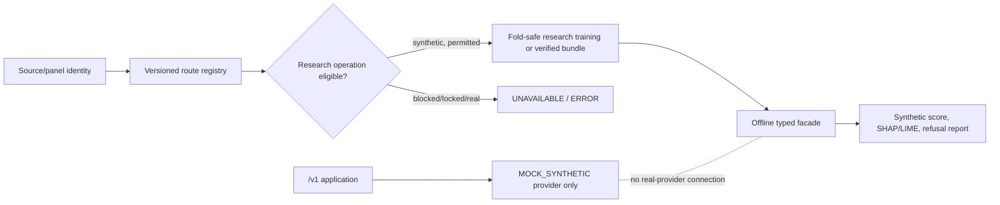

# CardioAssist AI: A Source-Specific, Reproducible Research Prototype for Retrospective Angiography-Referenced Coronary Artery Disease Assessment

**AI-12.2 Graduation Research Manuscript — substantive version 0.1 (scientific review draft)**  
**Research classification:** retrospective, source-specific internal exploratory benchmarks + independently tested **synthetic software prototype**.  
**Prepared:** 19 November 2026; **source snapshot** `897eaf61030636edae8dd5ac2ecc7dacf2870f02` (after PR #95).  
**Authors, university identifiers and formally approved supervisor:** must be supplied and approved by the actual contributors/institution; not invented in this draft.  
**Status:** `WORKING_MANUSCRIPT_NOT_ACCEPTED_FOR_FINAL_SUBMISSION`. All chapters contain substantive content, but independent scientific review, report layout, original protected-report checking where permitted, and final source-SHA Windows acceptance remain outstanding.  
**Navigation:** [28-claim source index](RH01_CLAIM_EVIDENCE_INDEX_2026_11_19.json) · [RH-01 source/gap review](RH01_SOURCE_EVIDENCE_AND_GAP_MATRIX_2026_11_19.md) · [AI-12.2 acceptance blueprint](AI12_2_FINAL_REPORT_BLUEPRINT_2026_11_19.md).  
**Ethical/use boundary:** no new data access, patient-level prediction, training, protected report export, or model serving was performed in the preparation of this manuscript. Historical aggregate metrics are quoted from archived research reviews as **maintainer-reported**, not newly reproduced.

---

## FR-01. Abstract and contribution

**Background.** Artificial intelligence for coronary artery disease (CAD) is often described using isolated discrimination scores on small tabular datasets. Those scores can obscure differences in reference outcomes, predictor acquisition, cohort selection, and calibration. A technically functional model is also not automatically suitable for a pre-angiography clinical encounter.

**Objective.** Build and document a reproducible, versioned and fail-closed **research prototype** that evaluates historical, angiography-referenced, cross-sectional CAD presence within each admissible cohort; keeps cohorts and outcome definitions separate; and provides an offline synthetic inference, explanation and software-evidence path without suggesting clinical validity.

**Methods.** Previously authorized local internal exploratory reports were reviewed for one Cleveland `DA-A2` 303-record benchmark with five source-defined features, and a separate UCI-412 `DA-A1` 303-record benchmark with a 16-field source-specific panel. Both used repeated nested stratified cross-validation (five outer folds, four repeats, five inner folds), fold-contained preprocessing and bounded logistic-regression/random-forest selection, with reference-only baselines and label-shuffle negative checks. Software engineering separately includes strict model/panel/route bindings, versioned contracts, real bundle integrity controls for allowed offline operations, explicit refusal statuses, genuine offline SHAP/LIME on synthetic fixtures, and deterministic synthetic paired-labs and locked-site rehearsals.

**Results.** Historical Cleveland primary inner-selected procedure AUROC was **0.8271 ± 0.0097**; historical UCI-412 inner-selected AUROC was **0.9107 ± 0.0071**. Each “±” is a **descriptive population SD across four dependent CV repeats using the same 303 subjects**—not a standard error or confidence interval. Their targets, predictor panels and populations differ, so **there is no valid between-dataset performance ranking**. Existing accepted Windows evidence demonstrates synthetic pipeline behavior but **no real independent Hungary evaluation or clinical-grade calibration**. UCI-412 pre-angiography timing is owner-unverified for all 16 panel fields and new real research remains on scientific hold.

**Conclusion.** The project demonstrates **historical internal exploratory feasibility and independently scoped synthetic engineering reproducibility**. It does **not** establish a patient-facing clinical predictor, a validated individual risk percentage, external transportability, causal explainability or new real laboratory incremental benefit. The prototype is a defendable research/software contribution only when these restrictions and the pending review results are supplied alongside its numerical findings.

**Keywords:** coronary artery disease; retrospective prediction; nested cross-validation; synthetic research; source admissibility; calibration; explainable AI; reproducibility; software safety.

## FR-02. Clinical motivation, research question and intended use

The proposed Track A question is: **Among individuals in a historically referred source cohort with a source-defined angiographic reference outcome, can a prespecified panel of recorded information discriminate concurrent obstructive CAD status as represented by that cohort?** The project intends a pre-reference-test *research assessment moment*, but the historical files do not conclusively establish the collection time of every predictor. Therefore the observed experiments are retrospective internal feasibility benchmarks, **not validated pre-catheterization clinical scoring tools**.

Track A is a **diagnostic cross-sectional** research question and cannot be silently reinterpreted as predicting 30-day myocardial infarction, all-cause mortality, disease severity, a future treatment need, or cardiovascular risk in an unselected population. The outcome is adjudicated by each historical data source, which can have different reference standards and label conventions. Track B (`/v1/monitoring` and optional future wearable signals) concerns observation/monitoring and is intentionally isolated from the Track A feature panel. No Track B value is accepted as an unregistered CAD model predictor.

The setting matters. Subjects referred for angiography are not a random sample of adults in Egypt or any future clinic. Case mix, referral and verification processes, sample era, clinical practice and source prevalence affect performance interpretation and prospective applicability. The intended defensible contribution is a transparent experimental and engineering framework, not a clinical decision-support intervention.

**Original evidence:** [Master Plan v1.7](../CARDIOASSIST_AI_MASTER_COMPLETION_PLAN.md) ``1–6; [source-specific synthesis](../gate-pt/11_two_dataset_scientific_evidence_synthesis_REVIEW_DRAFT.md) ``1–2. Source claim `CL-001`.

## FR-03. Related work, scientific reporting and evidence-selection policy

Historic tabular CAD datasets are widely used because they are accessible, relatively small and suitable for controlled modelling demonstrations; none supplies a shortcut past cohort/source admissibility. The original UCI Heart Disease collection records Cleveland, Hungary, Switzerland and VA Long Beach sources, while UCI Z-Alizadeh Sani is an independent named tabular cohort with a different source-defined outcome convention. The UCI-411 “extension” explicitly adds angiography-derived LAD/LCX/RCA variables to the same 303-subject source lineage, making patient independence and leakage concerns central.

The project retained a curated original literature classification and reviewed methods reports under `docs/research/gate-da` and `docs/research/gate-pt`, with source-quality and verification classes. **A reported result from an existing local authorized run is labelled maintainer-reported (MR); code inspection establishes implementation (AR), not an independent rerun; an original dataset owner page establishes only the propositions it explicitly documents; a synthetic test is software evidence only.** Secondary papers do not cure an absent original field-acquisition codebook.

The research reporting is informed by **TRIPOD+AI** (Collins and colleagues, *BMJ* 2024;385:e078378, DOI 10.1136/bmj-2023-078378) and the subsequent **PROBAST+AI** quality/risk-of-bias and applicability framework (*BMJ* 2025;388:e082505, DOI 10.1136/bmj-2024-082505). These frameworks provide reporting/appraisal questions, **not an ethics approval or certification**. Their application is described transparently in FR-15, with missing evidence labelled unassessable rather than converted to a false low-risk judgment. Methodological sample-size evidence and its conditional assumptions come from [Gate PT M2e.1](../gate-pt/05_m2e1_sample_size_research_ADEQUACY_REVIEW_DRAFT.md).

**External primary references:** [UCI-45](https://archive.ics.uci.edu/dataset/45/heart+disease), [UCI-412](https://archive.ics.uci.edu/dataset/412/z+alizadeh+sani), [UCI-411](https://archive.ics.uci.edu/dataset/411/extention+of+z+alizadeh+sani+dataset), [TRIPOD+AI](https://doi.org/10.1136/bmj-2023-078378), [PROBAST+AI](https://doi.org/10.1136/bmj-2024-082505).

## FR-04. Cohorts, source provenance, permitted roles and endpoint differences

The study is **not** a merged dataset classifier. Each source is assigned a scientific role before one can discuss training, incremental labs or independent assessment.

| Source | Original/public and archived repository facts | Research role | Current eligibility limit |
|---|---|---|---|
| UCI-45 processed Cleveland / DA-A2 | Historical processed cohort; **303** individuals, **139** with `num=1..4` and **164** with `num=0` in the archived local report; original UCI page describes conventional angiographic presence labels | Historical five-input internally evaluated feasibility benchmark | Original data and protected original run remain outside GitHub; pretest timing and sample-size/calibration limits |
| UCI-412 Z-Alizadeh Sani / DA-A1 | **303**, 216 `Cad` and 87 `Normal` in archived protected-run aggregates; owner defines **≥50%** stenosis | Separate historical 16-feature internally evaluated benchmark | 16/16 preangiography acquisition times unverified; new real model research **SCIENTIFIC_HOLD** |
| UCI-45 Hungary | Historical processed aggregate **294**, with existing local audit 188/106 class counts, multiple source-compatibility warnings | Conditional **locked one-shot** external-site candidate for a separately frozen Cleveland model | No approved/executed real external validation; subject independence, target/feature/time equivalence and precision unresolved |
| UCI-45 VA Long Beach | Historical processed aggregate **200**; significant missingness | Candidate missingness/domain-shift suitability or exploratory stress question | Separate source and precision/eligibility assessment required |
| UCI-45 Switzerland | Historical processed aggregate **123**, missingness and scarcity of certain laboratory entries | Source suitability / stress-analysis review only | Too many source/precision questions to call an independently qualified validation cohort |
| UCI-411 | Same named **303** UCI-412 participants, with added angiography-related LAD/LCX/RCA definitions in owner documentation | Cohort-overlap and target-leakage audit | **Never an independent external validation cohort** |
| UCI-145 Statlog Heart | Official **270**; UCI describes similarity to other Heart Disease records | Overlap, provenance and label-meaning audit | Person-level independence unverified |
| AngioCAD | Recent article abstract describes **413 angiography videos** with segment annotations and accompanying clinical/demographic/laboratory information | Possible alternative modern source *only if* an original eligible pre-index tabular cohort is documented | Patient-level tabular eligibility, reuse/rights, time, endpoint, independence and actual accessible file schema unverified; **not admitted** |
| CADICA / ARCADE / other candidates | Different imaging/annotation tasks or limited/uncertain source suitability in existing research register | Exclusion or separate future imaging work | Not compulsory added tabular training data |

**Critical endpoint distinction:** UCI-45's original documentation describes an angiographic 0 <50% vs 1 >50% contrast and historical processed labels 0 vs 1–4, whereas UCI-412 says CAD at **≥50%**. Neither owner release establishes exact-50% record equivalence across files. There is **no pooling, automatic target remapping, country-level generalization, or ranking between source-specific AUROC values**.

Original source inspection and primary links belong to [Gate PT docs 06, 07, 12 and 15](../gate-pt/12_dataset_selection_and_clinical_workflow_alignment_REVIEW_DRAFT.md), [M2f Hungary](../gate-pt/07_m2f_hungary_scientific_decision_and_conditional_protocol.md), and [AI-8R admissibility](../ai8r/SOURCE_ADMISSIBILITY.md). Proposed new source adjudications are tracked separately in RH-02; no metadata review opens a real-data authorization.

## FR-05. Predictor design and acquisition eligibility

The Cleveland **DA-A2 resting five-field** panel is `age`, `sex`, `cp`, `trestbps` and `restecg`; its reference-coded logistic regression encodes **eight slope coefficients**, because `cp` and `restecg` are multi-category fields. UCI official descriptions identify `trestbps` as **resting blood pressure on hospital admission in mmHg** and `cp` as a four-level source category. A single new-app office-BP textbox is not necessarily the historical variable. The complete versioned source validator exists under `research/intake/schemas/cleveland_resting_five_field_mapping.v0.1.json`; it is explicitly a synthetic research mapping **PROPOSED_NOT_APPROVED**, not a signed clinical acquisition contract.

UCI-412 uses `uci412_basic_clinical_v1`, 16 source columns: `Age`, `Sex`, `BMI`, `DM`, `HTN`, `Current Smoker`, `EX-Smoker`, `FH`, `DLP`, `BP`, `PR`, `Typical Chest Pain`, `Atypical`, `Nonanginal`, `Exertional CP` and `Dyspnea`. The registered executable contract distinguishes continuous, numeric-binary and text-binary fields, strict source vocabulary and disallowed angiography-derived information. Three larger UCI-412 panels (resting ECG, expanded clinical and core labs) are **blocked**, not automatically selectable alternate models.

All 16 UCI-412 fields are currently **below owner-verified preangiography timing**. Specifically, BP's type of measurement (systolic/diastolic), PR's unit/notation, the direction of six numeric 0/1 fields and the relationships among chest-pain indicators remain unresolved. Registered source encodings are protective software contracts, **not proof of original meaning or timing**. UCI-411's LAD/LCX/RCA and `Cath` encode angiography-related outcomes and cannot be pretest predictors for the same target. The two panels are deliberately not cross-translated.

**Acquisition architecture:** A future doctor-facing data intake would document source (`patient_history`, `clinician_examination`, `existing_lab_report`, `OCR_candidate`, etc.), actual timestamp, units, reviewer confirmation and reason for missingness **before** the research facade validates eligibility. OCR may extract candidate text from a document but cannot certify medical meaning, provenance or timing. Unresolved or unavailable features must produce refusal, `ABSTAIN` or `UNAVAILABLE` according to the binding route—not a guessed placeholder.

**Trace:** `CL-003`, `CL-011`, `CL-016`, `CL-017`; [original admissibility](../ai8r/SOURCE_ADMISSIBILITY.md), [UCI-412 frozen dictionary](../../../research/uci412/schemas/uci412_feature_dictionary.v1.json), [Cleveland mapping](../../../research/intake/schemas/cleveland_resting_five_field_mapping.v0.1.json).

## FR-06. Methods: preprocessing, model families and nested internal evaluation

The existing frozen single-source methods reports describe **outer five stratified folds × four repeats**, with **inner five folds** for bounded candidate/grid selection. Each repeat repartitions the **same 303 individuals**; there are not 1,212 independent records. Preprocessing is fitted within training partitions only: numeric median imputation, standardization for linear models, most-frequent categorical handling and source-frozen reference one-hot encoding. The selection criterion uses **inner-fold AUROC** and a predeclared **0.01 AUROC simplicity preference for L2 logistic regression** relative to the best candidate. No whole-cohort label-aware feature selection is permitted.

Candidate families and prespecified settings in the historical Cleveland D-047 protocol:

| Method | Frozen bounded configuration | Role |
|---|---|---|
| Prevalence dummy | Fitted prior on outer-training fold | Chance/prior-only reference |
| L2 logistic regression | `solver=liblinear`, `C∈{0.1,1,10}`, up to 2,000 iterations | Interpretable tabular bounded candidate |
| Constrained random forest | 200 trees; depth in {3,5}, min leaf in {5,10}, `max_features=sqrt` | Nonlinear bounded candidate |
| Inner-selected procedure | Choose family/hyperparameters by inner CV, 0.01 LR simplicity preference | **Primary registered performance estimand** |
| Label permutation | Three prespecified shuffle controls | Sanity/smoke check, not a formal permutation test |

The UCI-412 M3a experiment used a separately frozen but similar source-specific repeated nested-CV design with distinct 16-field input and target semantics, not a transfer experiment between sources. Each CV fold selection should use only its own training partition; the outer held-out fold is evaluated once under the registered procedure. The fixed **0.50** classification threshold in historic tables is descriptive only, **never an approved treatment or catheterization trigger**.

**Leakage controls** are reflected in registered prohibited-predictor lists, source-hash/preprocessing gates, model-family selection within nested CV, absence of test-derived feature selection, and separation of tracks and source-specific target maps. These controls substantially reduce software wiring errors but do **not** eliminate unobserved patient duplication, retrospective predictor timing bias or site/process proxies. This manuscript did not rerun original protected D-047 or M3a data and cannot independently audit the hidden local protected logs.

**Methods original records:** [D-047 original reported results ``2–4](../gate-pt/04_d047_first_internal_results_REVIEW_DRAFT.md); [M3a source-specific synthesis ``2–4](../gate-pt/11_two_dataset_scientific_evidence_synthesis_REVIEW_DRAFT.md), frozen plans under `research/experiments` and `research/uci412`. Claims `CL-003/004/011/012`.

## FR-07. Historical within-source real exploratory results

The following are the project's **previously recorded local/internal aggregate outcomes**, not observations from the present reporting pass. All values are **mean ± population SD across four dependent CV repeat metrics**, not participant-level uncertainty, confidence intervals, independent sites, significance tests or externally verified medical accuracy.

### Table T-02. Cleveland D-047 (n=303; 139 positive, 164 negative)

| Metric | Prevalence dummy | L2 logistic regression | Constrained RF | Inner-selected (primary) |
|---|---:|---:|---:|---:|
| AUROC | 0.4947 ± 0.0000 | 0.8292 ± 0.0062 | 0.8211 ± 0.0085 | **0.8271 ± 0.0097** |
| AUPRC / average precision | 0.4559 ± 0.0000 | 0.7737 ± 0.0151 | 0.7544 ± 0.0151 | **0.7712 ± 0.0193** |
| Accuracy at exploratory 0.50 | 0.5413 ± 0.0000 | 0.7739 ± 0.0050 | 0.7492 ± 0.0096 | 0.7723 ± 0.0077 |
| Sensitivity at exploratory 0.50 | 0.0000 ± 0.0000 | 0.7536 ± 0.0060 | 0.7410 ± 0.0088 | 0.7536 ± 0.0060 |
| Specificity at exploratory 0.50 | 1.0000 ± 0.0000 | 0.7912 ± 0.0066 | 0.7561 ± 0.0149 | 0.7881 ± 0.0117 |
| Brier score | 0.2483 ± 0.0000 | 0.1658 ± 0.0026 | 0.1745 ± 0.0038 | **0.1671 ± 0.0049** |

L2 logistic regression was selected in **19/20** outer folds under the simplicity rule. Three label shuffles gave a reported mean **0.4882 AUROC**. This is consistent with a chance-level negative-control smoke, **not** a p-value or definitive data-leakage exclusion. All original values and repeated AUROC entries are in [D-047 `4](../gate-pt/04_d047_first_internal_results_REVIEW_DRAFT.md); claims `CL-002…CL-009`.

### Table T-03. UCI-412 M3a (n=303; 216 Cad, 87 Normal)

| Metric | Prevalence dummy | L2 logistic regression | Constrained RF | Inner-selected (primary) |
|---|---:|---:|---:|---:|
| AUROC | 0.4913 ± 0.0000 | **0.9107 ± 0.0071** | 0.8978 ± 0.0026 | **0.9107 ± 0.0071** |
| AUPRC / average precision | 0.7089 ± 0.0000 | **0.9504 ± 0.0077** | 0.9471 ± 0.0032 | **0.9504 ± 0.0077** |
| Accuracy at exploratory 0.50 | 0.7129 ± 0.0000 | 0.8771 ± 0.0027 | 0.8350 ± 0.0062 | 0.8771 ± 0.0027 |
| Sensitivity at exploratory 0.50 | 1.0000 ± 0.0000 | 0.9225 ± 0.0038 | 0.9155 ± 0.0060 | 0.9225 ± 0.0038 |
| Specificity at exploratory 0.50 | 0.0000 ± 0.0000 | 0.7644 ± 0.0129 | 0.6351 ± 0.0339 | 0.7644 ± 0.0129 |
| Brier score | 0.2047 ± 0.0000 | **0.0995 ± 0.0043** | 0.1156 ± 0.0023 | **0.0995 ± 0.0043** |

L2 logistic regression was selected **20/20** outer folds; hence primary inner-selected and supportive LR outcomes coincide rather than constituting independent evidence. The maximum prespecified shuffled-label AUROC reported was **0.5503**, below original smoke warning/alarm boundaries, but still does not disprove all leakage. Original aggregate details and uncertainty are reported in [M3a synthesis `4.5](../gate-pt/11_two_dataset_scientific_evidence_synthesis_REVIEW_DRAFT.md). Claims `CL-011…CL-014`.

### Interpretation

The above results are **two distinct single-source internal feasibility summaries**. Comparing 0.9107 versus 0.8271 to declare a superior model would be scientifically invalid: the cohorts, source-defined endpoints (>50 vs ≥50), predictor quantity, label balance, disease mix and baseline conditions differ. No new real held-out external cohort was scored in either benchmark. A high AUROC on 303 historical referred people cannot be advertised as an individual clinical CAD probability.

## FR-08. Implemented synthetic engineering and reproducibility results

The system's software contributions were developed and tested **independently of any new patient training**. GitHub and maintainer-provided Windows acceptance records document these previously completed synthetic-only work slices:

| Software slice | Demonstrated and bounded behavior | Historical evidence |
|---|---|---|
| AI-7 / AI-8 | Versioned source-specific routes, synthetic cohorts, strict original panel identity, held-out synthetic evaluation and source-guarded negative cases | [AI-7 docs](../ai7_multi_dataset_research_route_system.md), [AI-8 docs](../ai8_uci412_standalone_synthetic_research_model.md) |
| AI-8R | Source admissibility register, machine-readable guarded hold; no new patient-level research | [AI-8R](../ai8r/SOURCE_ADMISSIBILITY.md) |
| AI-9.1 | Same fictional patient IDs/labels/folds in clinical-only and clinical-plus-labs paired comparison, versioned schema, controlled statistical report and refusal tests | [AI-9.1 closeout](AI9_1_MERGE_AND_WINDOWS_ACCEPTANCE_2026_11_18.md); fake effect not laboratory evidence |
| AI-10.1 | Fabricated locked external-site site-shift rehearsal with versioned fake cohorts, single-use ledger, source and schema checks and deliberate refusal branches | [AI-10.1 closeout](AI10_1_MERGE_AND_WINDOWS_ACCEPTANCE_2026_11_18.md); no real Hungary assessment |
| AI-11.1 | Typed synthetic-only offline facade with `SYNTHETIC_RESULT`, `ABSTAIN`, `UNAVAILABLE` and `ERROR` | [AI-11.1/12.1 closeout](AI11_1_AI12_1_CLOSEOUT_2026_11_18.md) |
| AI-11.2 | Read-only five-slot source-derived research catalog, integrity-checked serialized metadata and blocked/locked route status | [AI-11.2 closeout](AI11_2_MERGE_AND_WINDOWS_ACCEPTANCE_2026_11_18.md) |
| AI-12.1 | Deterministic eight-stage offline synthetic demonstration and canonical JSON evidence pack with privacy-safe refusals and cross-platform comparisons | [AI-12.1 runbook](../ai12_1/README.md), [merged evidence closeout](AI11_1_AI12_1_CLOSEOUT_2026_11_18.md) |

**No synthetic AUROC, Brier or paired-laboratory delta is a medical model result.** Fabricated shifted-site subjects, synthetic prediction scores and SHAP/LIME values test the *software* and the requested mathematical contracts; they do not establish predictive performance in genuine Cleveland, Hungary or UCI-412 patients.

**Architecture (research-only, conceptual wiring of existing modules):**



The architecture is a source-to-module diagram and must not be misread as an online clinical serving system.

## FR-09. Explainability: score scales, fidelity and limitations

The offline research engine includes genuine **grouped interventional SHAP** and **tabular LIME**, implemented in `ai/explainability.py`, `ai/lime_explainability.py` and `ai/lime_quality.py`. These are not simply colorful mock output strings, although the application HTTP provider is still synthetic-only.

For an L2 logistic regression with a compatible cross-fitted log-odds calibrator, the SHAP composition may be additive on **calibrated log-odds**, a scale that is **not calibrated probability**. The implementation specifies the explained quantity and whether exact additivity applies; tree attributions are on the raw-model probability scale, not automatically additive on a later nonlinear calibrated score. The reported SHAP baseline/background is a versioned training-derived reference. For real source rows, background features can be re-identifiable patient-derived data even if encoded, so those artifacts are protected and **not** published as thesis examples.

The LIME implementation perturbs an interpretable mask relative to a documented local background reference and uses a local weighted surrogate with quality/fidelity measures. Approximate surrogate fidelity can fail or be unstable, depending on feature/sample/repeat context; an explanation must report method/target/scale and quality **or decline to explain**. Neither mathematical additivity nor LIME fidelity establishes causal feature importance, individualized treatment advice, fairness, or clinical validity.

**Reportable result:** The source code and prior tests implement measurable explanation-fidelity and fail-closed contracts in **synthetic/offline research**. A future study with real explanations needs separately admitted data, source background provenance, clinical review and privacy protection. Claims `CL-023/024`.

## FR-10. Calibration, statistical uncertainty and sample-size constraints

AUC/AUPRC describe ranking on the specified cohort and outcome; **Brier score** quantifies mean squared error of probability-like model outputs within that same sample. Neither alone proves that an individual clinician/patient can safely interpret a number as a calibrated CAD probability in a new setting.

Historical calibration reports distinguish an **offset-only calibration-in-the-large (CITL) intercept** from a **joint free intercept/slope fit**. A null `UNSTABLE_OR_NOT_ESTIMABLE` slope is **not zero**; a numerical slope is a descriptive diagnostic, **not** evidence of adequate clinical calibration. No recalibration was applied to these experimental predictions on the basis of those descriptive summaries.

### Table T-04. Reported historical calibration diagnostics (NOT medical reliability verdicts)

| Source | Model/procedure | Descriptive mean OOF slope | Estimable repeats | Mean CITL |
|---|---|---:|---:|---:|
| Cleveland | LR | 0.9105 | 3/4 | −0.0192 |
| Cleveland | constrained RF | 1.3710 | 3/4 | −0.0033 |
| Cleveland | inner-selected | **0.8980** | 4/4 | **−0.0212** |
| UCI-412 | LR | **1.0891** | 4/4 | **0.0206** |
| UCI-412 | constrained RF | 1.5700 | 3/4 | 0.0020 |
| UCI-412 | inner-selected | **1.0891** | 4/4 | **0.0206** |

These source-specific values **must not be compared as a calibration contest** across incompatible cohorts. Joint free calibration intercepts and reliability-bin values were not supplied for publication; no invented calibration plots have been generated. Per-repeat details and statuses are in [Cleveland `5](../gate-pt/04_d047_first_internal_results_REVIEW_DRAFT.md) and [UCI-412 `4.6](../gate-pt/11_two_dataset_scientific_evidence_synthesis_REVIEW_DRAFT.md).

### Sample size and inferential precision

The existing M2e.1 worked calculation reports that the **Cleveland 303** records fall short of a **382**-participant outcome-fraction criterion at the stated ±0.05 tolerance; a separately reported p=8 MAPE criterion needs **459** under its specified setting. For UCI-412, a source/fraction criterion at its stated tolerance needs **315**, exceeding its historical 303; other R²-sensitive development adequacy criteria were not assessed. No valid confidence interval for headline **four-dependent-repeat mean±SD** is supplied. The reported SD is partition-level descriptive variability, **not** a confidence interval, a standard error or a distribution of new patients.

These results motivate describing the experiments as small-source feasibility rather than proving clinical adequacy. Neither a change of tolerance nor a study that cannot be evaluated from permitted aggregates may be declared passed post hoc. Original methods and numerical assumptions: [M2e.1](../gate-pt/05_m2e1_sample_size_research_ADEQUACY_REVIEW_DRAFT.md) and [M3a synthesis `5](../gate-pt/11_two_dataset_scientific_evidence_synthesis_REVIEW_DRAFT.md). Claims `CL-009/010/014/015`.

## FR-11. Conditional real clinical-versus-laboratory incremental-value hypothesis (AI-9.2)

**Research hypothesis:** Within the **same eligible source cohort**, does a prespecified set of already-measured, pre-index routine laboratory attributes improve discriminative performance, calibration and useful decision information beyond a fixed clinical-only panel on **paired subjects and fold partitions**? A more complex feature set cannot be assumed superior from clinical plausibility or a synthetic paired experiment.

**Prespecified eligibility prerequisites:** owner-authenticated predictor definitions, units and true collection time; explicit handling of lab missingness; patient ID matching/availability; source-defined target; sufficient cases and effective information/precision; a fixed comparison protocol and statistical estimands; scoped, written local authorization; and a permitted aggregate-only external reporting plan. Nested selection, preprocessing and uncertainty must preserve patient pairing; fold/subject alignment and model complexity must not be chosen after examining evaluation outcomes.

**Actual recorded outcome as of this manuscript baseline:** **AI-9.2 REAL STUDY NOT EXECUTED; NO CLINICAL INCREMENTAL VALUE ESTABLISHED.** AI-9.1 only demonstrates a validly guarded **synthetic software** version of the paired design. UCI-412's 16 clinical variables are under source-timing hold, and that does not indirectly grant an approved clinical+labs extension. This limitation must be included in the results abstract and graduation defense.

**Decision required:** a named human scientific/research owner must issue either a truly bounded **GO** with the necessary source rights and eligible protocol, followed by an actual independently reviewed local study, or a reasoned **NO-GO/HOLD**. A documented no-go closes only prototype decision tracking; it is not a positive evidence claim that labs add or fail to add medical predictive value.

## FR-12. Conditional independent external transportability question (AI-10.2)

**Research hypothesis:** Apply a frozen, authorized Cleveland-derived source-specific model **without refitting, selecting thresholds or inspecting the held-out site outcomes for model choice** to a genuinely independent eligible dataset such as Hungary, then estimate discrimination, calibration and feasibility with an honest precision account.

**Eligibility checklist:** (i) actual participant/site independence or explicitly reduced estimand; (ii) compatible source endpoint, including exact-50% boundary handling and site reference standard; (iii) complete prespecified five-feature source coding/units and acquisition timing; (iv) source eligibility, missingness and planned denominator; (v) a frozen model artifact, preprocessing and calibrator with authenticated versions; (vi) precision adequacy for the proposed estimands; (vii) permitted data access/ethics as applicable; (viii) locked one-shot protocol and auditable ledger.

**Known blockers:** Hungary processed 294 versus historical raw-size/correspondence questions; partial missingness; source/patient overlap not proven; target, feature and pre-cath compatibility not independently established; and no separate authorized real run. The `ExternalEvaluationLedger` and AI-10.1 synthetic fixed-site rehearsal make accidental repeat evaluation harder as software, but do **not** establish actual source independence, patient identity or clinical research ethics.

**Actual recorded outcome as of this manuscript baseline:** **REAL AI-10.2 EXTERNAL VALIDATION NOT EXECUTED**. The thesis must explicitly state “not externally validated” and must not substitute Statlog or UCI-411 without provenance. A negative scientific eligibility outcome is a limitation and possible future work, not a completed transportability result.

## FR-13. Software interface, provenance and later app integration

The registered research model stack is versioned and source-specific: `ai/panels.py` defines panel semantics; `ai/research_routes.py` binds operation to source; `ai/research_registry.py` records synthetic-only model identities and governance; `ai/research_catalog.py` exports metadata without loading models; `ai/research_facade.py` validates requests and returns one of four statuses. Inferences require exact allowed source/route/panel/version/contract and eligible synthetic provenance, else fail closed. The software deliberately rejects outcome-label leakage, Track B wearable contamination, unsupported or missing field values and untrusted bundles.

**Four typed offline research statuses:**

| Status | Legal meaning | Display/UI requirement |
|---|---|---|
| `SYNTHETIC_RESULT` | Numeric score for an invented input fixture, not an individual real CAD risk | Clear “synthetic research demonstration” label |
| `ABSTAIN` | Registered inference policy intentionally produces no score | Show reason, missing field or policy, never infer missing values as zero |
| `UNAVAILABLE` | Valid known route/capability is blocked or not present in an admitted synthetic bundle | Show unavailable with capability/decision reason, no fallback |
| `ERROR` | Invalid version, field, source, units, data provenance or artifact/security state | No score or unredacted private details; actionable safe error |

**Application boundary:** `backend/app/inference/registry.py` constructs **`MOCK_SYNTHETIC`** only. `backend/app/inference/real_model.py` is a deliberately unconstructible placeholder. The real medical model does **not** get silently activated just because a source report documents internal exploratory AUROC. The mock HTTP API and its SHAP-shaped fixtures are distinct from the actual offline SHAP/LIME mathematical engines.

**Later demo handoff:** For a Flutter/React + FastAPI + local DB **synthetic research prototype**, use fixture-only examples, typed feature validation, audit/consent for demonstration data and locked Track A/Track B separation. OCR is upstream, a proposed acquisition candidate only; it must be checked by a clinician/authorized operator, and must not infer the historical dataset source's undocumented variable definitions. App engineering does **not** change P-1/P-3 or create clinical serving permission. Claims `CL-021/022/025`.

## FR-14. Engineering tests, source integrity, reproducibility and privacy

Previously accepted exact-head/merge evidence from the project records illustrates rigorous engineering discipline. Counts below refer to **different historical source SHAs** and must not be summed into a single independently rerun suite:

| Historical synthetic software slice | Maintainer-recorded native Windows premerge full pytest | Additional evidence | Scope warning |
|---|---|---|---|
| AI-11.1/12.1 | **2,531 passed, 3 skipped, 0 failed** | Eight-stage synthetic demo; native Win32/NTFS security **8/8**; later focused and report/integrity smoke | No patient/model performance result |
| AI-11.2 | **2,553 passed, 3 skipped, 0 failed** | Catalog negative/contract tests; native security **8/8**, postmerge focused tests | Five catalog entries are not five clinically admitted models |
| AI-9.1 | **2,597 passed, 3 skipped, 0 failed** | Hosted CI 7/7 jobs, native security **8/8**, synthetic paired report | No real clinical/labs increment |
| AI-10.1 | **2,615 passed, 3 skipped, 0 failed** | Hosted CI 7/7 jobs; native security **8/8**; **18 focused postmerge** pass and schema/digest/one-shot report | **Full 2,615-test suite not rerun after merge**; no real external validation |

All full-suite counts are **maintainer-supplied native Windows evidence**, traced to original accepted closeout documents; not tests run during writing of this manuscript. The three platform-dependent skip records are reported as skips rather than converted to successes. Hosted GitHub workflow green does not replace native NTFS access-control checks where the specific gate demands them.

A typical permitted *synthetic-only* clean-environment demonstration described by the repository is:

```bash
python -W error -m ai.research_demo --format json
python -W error -m ai.research_evidence --output <new-private-synthetic-pack.json>
python -W error -m ai.research_evidence --compare <existing-approved-synthetic-pack.json>
```

Run commands **only in a reviewed permitted environment** according to the source runbook, using newly created external private paths rather than inside the repository, and do not copy/paste shell placeholders as real filenames. Cross-platform numerical library differences may change some report bytes; verify the supported same-environment canonical contracts and record differences rather than falsely claiming byte-identical SHA for different BLAS environments.

Safety restrictions: no protected dataset rows, patient-level predicted values, actual original `report.json`/`predictions.csv`, private SHAP backgrounds, authorization manifests, credentials, signing keys or secret-bearing file paths can be committed to GitHub. Release requirements later include a fresh exact-SHA run, pip/dependency check, source-integrity hash check, exact-head CI, Windows 8/8 ACL tests, specified negative cases, sanitized report digests, reviewer evidence, and justified skips. These are **pending RH-05/RH-07**, not assumed passed merely because this manuscript exists.

## FR-15. Bias, ethics, scientific validity and applicability appraisal

This is a **provisional source/method appraisal**, not a completed official PROBAST+AI domain scoring. The four domain concerns are:

| PROBAST+AI-style domain | Source-specific concern | Research implication |
|---|---|---|
| Participants/data sources | Small, historical, angiography-referred, highly selected and source-specific cases; possibly different prevalence/site/population | Spectrum, verification, selection and transportability limitations; cannot claim general public risk |
| Predictors | UCI-412 0/16 owner-verified pre-cath acquisition times, ambiguous BP/PR/chest-pain/binary definitions; Cleveland chronology also not certified | Retrospective information/leakage risk and mismatch with prospective UI measurement |
| Outcome | UCI-45 `<50/>50` versus UCI-412 `≥50`; exact boundary and source reference practice uncertain | No unverified label harmonization, direct cross-source comparison or silent pooling |
| Analysis | 303 records per separate cohort, outer repeats are dependent, some unstable calibration slopes, no external site, limited interval evidence | Internal discrimination is descriptive feasibility; neither population calibration nor confidence in future deployment established |

The project also has **technology risks**: possible model and calibration artifact version mismatch, insecure local file/ACL handling, unexpected provenance, serializing sensitive SHAP backgrounds, response overinterpretation, unauthorized real-model serving and user interface “medical score” labeling. These are mitigated in the prototype through fixed contracts, signed local provenance, source-hash checks, deterministic synthetic fixtures, refusal statuses, test evidence and an intentionally mock-only backend. No software safeguard proves that the historical source predictors were captured pre-angiography.

**Governance:** existing Gate PT P-1 remains pending, P-3 closed and P-5 clinically external/serving claims not made; local research experiments D-047/M3a were separate bounded exceptions, not blanket clinical approvals. This manuscript neither opens those gates nor represents itself as an ethics committee decision. Human author/supervisor approvals, faculty formatting, and any clinical use permission must be entered only if actually issued.

## FR-16. Discussion, limitations, contributions and conclusions

The main methodological contribution is disciplined **separation of research evidence types**. The historical Cleveland and UCI-412 experiments demonstrate internally coherent, bounded within-source retrospective discrimination on two named datasets with different feature panels and targets. The software contribution is a unified source-specific, offline and fail-closed *synthetic research system* that exercises training, preprocessing, calibration, integrity, SHAP/LIME, route selection, typed inference, abstentions and evidence reporting without exposing patient data or converting an unvalidated model into a public HTTP diagnostic service.

The principal scientific limitations are substantive rather than cosmetic: dataset age and selection; 303-subject cohorts; repeated nested CV dependence; lack of source pre-test timestamp validation (especially UCI-412); codebook/threshold ambiguity; incomplete calibration precision and unavailable reliability curves; unknown real person-level cross-site independence; no real incremental-labs outcome; and no independent locked external site performance. The synthetic shifted-site and paired-lab exercises therefore provide engineering readiness—not evidence that the laboratory-rich model is medically better or that a Cleveland model transports to Hungary.

**Conclusion appropriate for academic defense:** CardioAssist AI has a defensible **research-only software prototype with documented historical internal exploratory benchmarks and rigorous source/permission boundaries**. The evidence **does not support clinical patient risk percentages, cross-dataset model superiority, real external generalization or clinical use**. Completion of the full thesis package depends on reviewed source-admissibility decisions, release-SHA reproducibility and documentation acceptance; future genuine studies require separate prespecified protocols and rights. A reviewer should be able to reproduce the synthetic behavior and audit every research claim without accessing protected patient material.

## FR-17. Appendices: defense packet, source map and reproducibility handoff

### Appendix A. Canonical report-to-evidence traceability

| Result ID | Primary source in repository | Claim IDs | Scope |
|---|---|---|---|
| T-01 dataset/source matrix | [Dataset selection/clinical workflow](../gate-pt/12_dataset_selection_and_clinical_workflow_alignment_REVIEW_DRAFT.md); [source resolution](../gate-pt/15_scientific_evidence_resolution_and_development_route_REVIEW_DRAFT.md) | CL-001, CL-011, CL-016…CL-018 | Original metadata/maintainer local aggregate, no external validation |
| T-02 Cleveland metrics | [D-047 `4 original reported table](../gate-pt/04_d047_first_internal_results_REVIEW_DRAFT.md) | CL-002…CL-009 | Local historic internal exploratory |
| T-03 UCI-412 metrics | [M3a `4.5 historical synthesis](../gate-pt/11_two_dataset_scientific_evidence_synthesis_REVIEW_DRAFT.md) | CL-011…CL-015 | Source-specific internal exploratory |
| T-04 calibration | [D-047 `5](../gate-pt/04_d047_first_internal_results_REVIEW_DRAFT.md), [M3a `4.6](../gate-pt/11_two_dataset_scientific_evidence_synthesis_REVIEW_DRAFT.md) | CL-009, CL-014 | Descriptive, not clinical probability validity |
| T-05 source hold and UCI-411 | [AI-8R source register](../ai8r/SOURCE_ADMISSIBILITY.md) | CL-016, CL-017 | Documentation and scientific restrictions |
| T-06 conditional studies | [M2f Hungary](../gate-pt/07_m2f_hungary_scientific_decision_and_conditional_protocol.md), [AI-9/10 closeouts](AI9_1_MERGE_AND_WINDOWS_ACCEPTANCE_2026_11_18.md) | CL-018…CL-020 | Unperformed real study, synthetic engineering only |
| T-07 software/test table | [AI-11/12](AI11_1_AI12_1_CLOSEOUT_2026_11_18.md), [AI-11.2](AI11_2_MERGE_AND_WINDOWS_ACCEPTANCE_2026_11_18.md), [AI-9.1](AI9_1_MERGE_AND_WINDOWS_ACCEPTANCE_2026_11_18.md), [AI-10.1](AI10_1_MERGE_AND_WINDOWS_ACCEPTANCE_2026_11_18.md) | CL-019…CL-026 | Historical software/maintainer validation |

**No real ROC/reliability curve figure is supplied here.** Curves cannot be reconstructed from rounded AUROCs/aggregate calibration slopes, and no protected per-person outputs were accessed. Any later permitted figure must have a complete versioned aggregate provenance record and be reviewed before inclusion. The Mermaid architecture is a code-level explanatory schematic, **not a model-performance plot**.

### Appendix B. Reproduction and artifact navigation

- Source registry and routes: `ai/research_registry.py`, `ai/research_routes.py`, `ai/research_catalog.py`, `ai/panels.py`.
- Main offline synthetic interface: `ai/research_facade.py`, `ai/research_demo.py`, `ai/research_evidence.py`; [AI-12.1 source runbook](../ai12_1/README.md).
- ML methods: `ai/training.py`, `ai/preprocessing.py`, `ai/calibration.py`, `research/experiments`, `research/uci412`.
- Explainability: `ai/explainability.py`, `ai/lime_explainability.py`, `ai/lime_quality.py`.
- Tests: `tests/experiments`, `tests/contracts`, `tests/audit`, `tests/backend`; native source/security utility `scripts/validate_ai_windows_compat.py`.
- Application mock-only inference boundary: `backend/app/inference/registry.py` and `real_model.py`.
- Scientific claims: [machine-readable original source/blob index](RH01_CLAIM_EVIDENCE_INDEX_2026_11_19.json), [RH-01 gap matrix](RH01_SOURCE_EVIDENCE_AND_GAP_MATRIX_2026_11_19.md), current [RH completion tracker](AI_RESEARCH_COMPLETION_TRACKER_2026_11_19.json), [AI-12.2 blueprint](AI12_2_FINAL_REPORT_BLUEPRINT_2026_11_19.md).

### Appendix C. References and source-level attribution

1. UCI Machine Learning Repository. *Heart Disease* (dataset 45; DOI [10.24432/C52P4X](https://doi.org/10.24432/C52P4X)). Original linked publication: Detrano R et al., *International application of a new probability algorithm for the diagnosis of coronary artery disease*, *American Journal of Cardiology* (1989).
2. Alizadehsani R, Roshanzamir M, Sani Z. *Z-Alizadeh Sani*, UCI ML Repository (dataset 412; DOI [10.24432/C5Q31T](https://doi.org/10.24432/C5Q31T)); related original methodology by Alizadehsani and coauthors, *Computer Methods and Programs in Biomedicine* (2013), DOI [10.1016/j.cmpb.2013.03.004](https://doi.org/10.1016/j.cmpb.2013.03.004).
3. UCI Machine Learning Repository. *extention of Z-Alizadeh sani dataset* (dataset 411; DOI [10.24432/C5461K](https://doi.org/10.24432/C5461K)).
4. UCI Machine Learning Repository. *Statlog (Heart)* (dataset 145; [official page](https://archive.ics.uci.edu/dataset/145/statlog+heart)).
5. Collins GS et al. TRIPOD+AI statement: updated reporting guidance for clinical prediction models using regression or machine learning. *BMJ* 2024;385:e078378. DOI [10.1136/bmj-2023-078378](https://doi.org/10.1136/bmj-2023-078378).
6. PROBAST+AI: updated quality, risk-of-bias and applicability assessment for clinical prediction model development and evaluation. *BMJ* 2025;388:e082505. DOI [10.1136/bmj-2024-082505](https://doi.org/10.1136/bmj-2024-082505).
7. The complete research source/method provenance, including Riley sample-size papers and actual evidence grades, remains maintained in [Gate PT M2e.1](../gate-pt/05_m2e1_sample_size_research_ADEQUACY_REVIEW_DRAFT.md), [Gate PT doc 11](../gate-pt/11_two_dataset_scientific_evidence_synthesis_REVIEW_DRAFT.md), and [Gate PT doc 15](../gate-pt/15_scientific_evidence_resolution_and_development_route_REVIEW_DRAFT.md).

### Appendix D. Open decisions, thesis honesty checks and owner/signature fields

| Review item | Evidence at manuscript creation | Needed before final thesis acceptance |
|---|---|---|
| Original-source meaning/timing | UCI-412 16/16 pretest times unverified; Cleveland chronology caution | Completed RH-02 decision record or explicitly retained scientific hold; human review |
| Medical model validity | Only historical internal real exploratory summaries; no external validation | Explicit limited claims, and conditional AI-9.2/10.2 GO or reviewed NO-GO recorded |
| Model performance uncertainty | No inferential CI for dependent-repeat headlines; small-source calibration limitations | Reviewer confirms all caveats and no fabricated statistical precision |
| Protected source provenance | Archived sanitized local aggregates; no source rows inspected while drafting | Permitted independent attestation (if requested) without exposing protected data |
| Software acceptance | Historic exact-SHA CI/Windows runs recorded | New final release-SHA E2E, CI and Windows/NTFS record with actual results |
| Document/editorial quality | Substantive FR-01…FR-17 manuscript exists as v0.1 | Scientific review, layout/citations, figure/table provenance, required university format |
| Authorship/supervision | Not supplied in this manuscript | Real contributors and any official approvals entered by authorized humans |
| Final manuscript SHA/release | Not yet assigned | Accepted PR/merge SHA + report digest and research-only release label |

**Claim guardrail:** `FINAL_RESEARCH_PROTOTYPE_HANDOFF_ACCEPTED` is **not** granted by this manuscript PR. Reviewers must adjudicate scientific source facts, complete the remaining RH-02/RH-05/RH-06/RH-07 gates as applicable, and approve this text before it is used as final academic submission.
